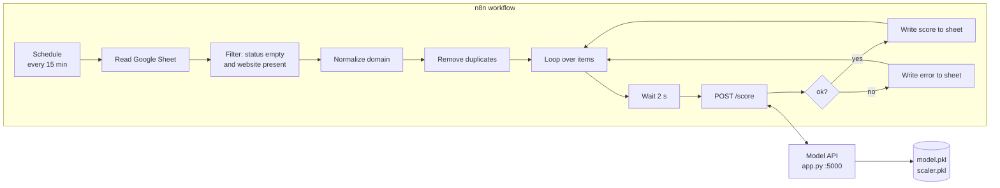
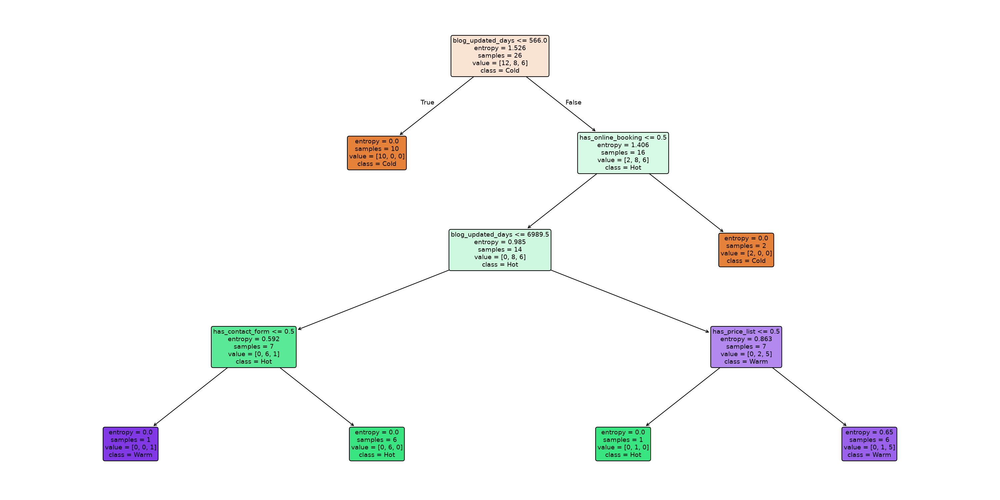

# AI Lead Scoring for Dental Clinics: ML Model + n8n Automation

An end-to-end lead scoring system. A **self-trained machine learning model**, served through a small REST API, scores dental clinic websites as **Hot / Warm / Cold** leads. An **n8n workflow** watches a Google Sheet of companies, sends each new website to the model API and writes the score back to the sheet automatically.

<!-- TODO: add a screenshot of the Google Sheet with scored leads and of the n8n canvas -->
<!--  -->

## What it does

1. Takes a list of company websites in a Google Sheet.
2. Normalizes each website to a clean domain and skips duplicates.
3. Calls the model API, which returns whether the lead is qualified, its label (`Hot`, `Warm` or `Cold`) and the probability of each class.
4. Writes the result (or the error) back to the same row, with a processing timestamp.

The sheet itself acts as the work queue: only rows with a website and an empty `status` are processed, so the workflow can run unattended every 15 minutes.

## System overview



## The model

<!-- TODO: fill in the details below from your own training code and results -->

| Item | Details |
|---|---|
| Task | Multi-class classification: `Hot`, `Warm`, `Cold` |
| Algorithm | [e.g. Decision Tree / Random Forest / Logistic Regression] |
| Dataset | [number] dental clinic websites, collected by scraping and labeled by [method] |
| Features | [number] features extracted from each website, such as [examples: booking form present, contact info, services listed, ...] |
| Preprocessing | Feature scaling (`scaler.pkl`), feature list saved in `feature_cols.pkl` |
| Evaluation | Train/test split and k-fold cross-validation |

### ML pipeline in this repository

| Stage | Files |
|---|---|
| 1. Data collection | `scraper_template_A.py`, `run_batch_scrape.py` |
| 2. Candidate filtering and merging | `filter_candidates.py`, `merge_final_list.py`, `candidates*.csv`, `final_company_list.csv`, `dropped_companies.csv` |
| 3. Labeling | `bootstrap_labeling.py`, `labeled.csv` |
| 4. Feature engineering | `feature_engineering.py`, `features.csv`, `feature_cols.pkl` |
| 5. Training and evaluation | `train_and_evaluate.py`, `kfold_evaluate.py` |
| 6. Final model | `train_final_model.py`, `model.pkl`, `scaler.pkl` |
| 7. Serving | `app.py` |

### Results

<!-- TODO: replace with your real numbers from train_and_evaluate.py and kfold_evaluate.py -->

| Metric | Value |
|---|---|
| Accuracy (test set) | [..%] |
| Macro F1 (test set) | [..] |
| k-fold cross-validation accuracy | [..% ± ..] (k = [..]) |



<!-- TODO: add the confusion matrix and the most important features, and explain in 2-3 sentences what the model learned -->

## Model API

The workflow expects the API at `http://host.docker.internal:5000/score` (the address of the host machine as seen from an n8n container).

**Request**

```http
POST /score
Content-Type: application/json

{ "url": "example-dental.com" }
```

**Successful response** (fields used by the workflow)

```json
{
  "ok": true,
  "qualified": "...",
  "lead_label": "Hot",
  "probabilities": { "Hot": 0.0, "Warm": 0.0, "Cold": 0.0 }
}
```

**Failure response**

```json
{ "ok": false, "error": "reason the site could not be scored" }
```

## n8n workflow details

| Step | What it does |
|---|---|
| Schedule Trigger | Runs every 15 minutes |
| Get Rows | Reads all rows of the Google Sheet |
| Filter | Keeps rows where `status` is empty and `website` is not empty |
| Normalize domain | Removes protocol, `www.` and path, lowercases the result |
| Remove Duplicates | Skips domains already processed in earlier runs |
| Loop Over Items + Wait 2s | Processes one lead at a time with a pause, to avoid overloading the API and the target sites |
| HTTP Request | Sends the domain to the model API |
| IF: ok? | Routes success and failure |
| Write result | Updates the row by `row_number`: `status`, `domain`, `qualified`, `lead_label`, `prob_hot`, `prob_warm`, `prob_cold`, `processed_at` on success; `status = error` and `error_message` on failure |

### Expected Google Sheet columns

`website`, `status`, `domain`, `qualified`, `lead_label`, `prob_hot`, `prob_warm`, `prob_cold`, `error_message`, `processed_at`

## Setup

1. **Clone the repository** and install the Python dependencies.
   ```bash
   git clone https://github.com/pamhanh/AI_Lead_Scoring.git
   cd AI_Lead_Scoring
   pip install -r requirements.txt   # TODO: add a requirements.txt to the repo
   ```
2. **Start the model API** (it loads `model.pkl` and `scaler.pkl`).
   ```bash
   python app.py
   ```
3. **Prepare the Google Sheet** with the columns above and put the websites in the `website` column.
4. **Import the workflow** (`lead_scoring_workflow.json`) into n8n, create a Google Sheets OAuth2 credential, select your sheet in the three Google Sheets nodes and check that the HTTP Request URL can reach your API. If n8n does not run in Docker, use `http://localhost:5000/score`.
5. **Activate the workflow.** New rows are scored automatically.

To retrain the model, run the pipeline in order: `run_batch_scrape.py` → `filter_candidates.py` → `bootstrap_labeling.py` → `feature_engineering.py` → `train_and_evaluate.py` → `train_final_model.py`.

## Design decisions

- **The sheet is the queue.** Using a `status` column makes the workflow idempotent: processed rows are not processed again, and failed rows are visible with their error message.
- **Separation of ML and automation.** The model is a standalone API, so it can be reused from n8n, scripts or any other tool.
- **Probabilities, not only labels.** Returning class probabilities lets a sales team rank leads and choose its own threshold.
- **Rate-limited, sequential processing.** A short wait between calls keeps the API and the scraped websites from being overloaded.
- **Errors are data.** Failures are written to the sheet instead of silently dropped.

## Known limitations and next steps

- The API runs locally, so the workflow only works while it is running. Deploying it (Docker, a cloud VM) would make the system independent of one machine.
- The API has no authentication.
- Rows that end with `status = error` are not retried automatically.
- Model quality depends on the size and labeling quality of the training set, so [state the dataset size and labeling method here].
- Ideas for improvement: more labeled data, probability calibration, monitoring of prediction drift, and a retraining schedule.

## Repository structure

```
.
├── README.md
├── app.py                         # model API
├── lead_scoring_workflow.json     # n8n workflow
├── model.pkl, scaler.pkl, feature_cols.pkl
├── scraper_template_A.py, run_batch_scrape.py
├── filter_candidates.py, merge_final_list.py
├── bootstrap_labeling.py
├── feature_engineering.py
├── train_and_evaluate.py, kfold_evaluate.py, train_final_model.py
├── decision_tree.png
└── *.csv                          # collected, filtered, labeled data and features
```

## License

MIT (or choose your own).
